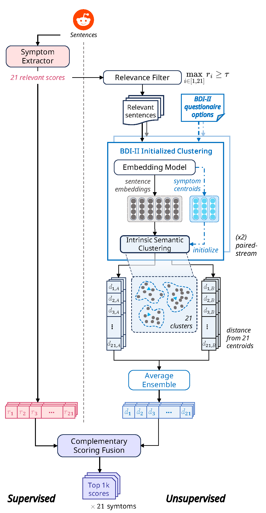

# Hysefus: Hybrid Semantic Fusion for Ranking Depression Symptoms

This repository contains the official implementation of **Hysefus**, a hybrid semantic fusion framework for ranking depression symptoms on social media, as described in our paper for the CLEF eRisk 2025 Task 1.


## Methodology Overview

Our model, **Hysefus**, formulates the task as a multi-label sentence classification problem. It assigns relevance scores to sentence-symptom pairs based on the 21 BDI-II depression categories. The architecture consists of three main components:

1.  **Supervised Depressive Symptom Extractor (`/extractor`)**: Leverages a fine-tuned `DepRoBERTa` model to generate initial symptom relevance scores from labeled data. This captures nuanced depressive language patterns.

2.  **Unsupervised Intrinsic Semantic Clustering (`/clustering`)**: Applies BDI-II symptom-initialized K-means clustering on unlabeled test data. This module uses a paired stream of `nomic-embed-text-v1.5` and `modernbert-embed-base` to generate robust semantic embeddings, mitigating domain shift and individual model bias. It includes a relevance filter to focus clustering on symptom-relevant sentences.

3.  **Complementary Scoring Fusion (`/fusion.py`)**: Harmonizes the supervised and unsupervised scores using a hybrid strategy of additive and maximum fusion, producing a robust final ranking.



## Repository Structure

```
.
├── clustering/           # Unsupervised module: embedding, K-means, filtering
├── data/                 # Raw and processed data
├── data_processing/      # Scripts for data loading and preparation
├── extractor/            # Supervised module: model, training, inference
├── figures/              # Model diagrams and plots
├── utils/                # Utility scripts and constants
├── evaluate.py           # Script for evaluating model predictions
├── fusion.py             # Script for fusing supervised and unsupervised scores
├── requirements.txt      # Python dependencies
└── README.md             # This file
```

## Setup and Installation

1.  **Clone the repository:**
    ```bash
    git clone https://github.com/your-repo/hysefus.git
    cd hysefus
    ```

2.  **Create a virtual environment and install dependencies:**
    ```bash
    python -m venv venv
    source venv/bin/activate
    pip install -r requirements.txt
    ```

3.  **Download necessary models:**
    The framework relies on several pre-trained models from Hugging Face. They will be downloaded automatically on the first run. Ensure you have a stable internet connection.

## Running the Pipeline

Follow these steps to preprocess data, run the models, and generate the final submission file.

### 1. Data Preparation

First, you need to obtain the eRisk 2025 Task 1 dataset. Please request access from the organizers at [https://erisk.irlab.org/eRisk2025.html](https://erisk.irlab.org/eRisk2025.html).

Once you have received the data, place the raw TREC-formatted files into the `data/erisk25-t1-dataset` directory.

After setting up the data, you can convert the raw TREC-formatted data into a more accessible CSV format.

```bash
python -m data_processing.trec_loader
```

Next, create the labeled dataset with corresponding text, which will be used for training and evaluation.

```bash
python create_labeled_data.py
```

### 2. Supervised Symptom Extraction

Run the supervised extractor to generate initial relevance scores for each sentence. Make sure to provide the path to your fine-tuned model checkpoint.

```bash
python -m extractor.infer --checkpoint_path path/to/your/checkpoint
```
This saves the predictions in `outputs/extractor_predictions/`.

### 3. Unsupervised Semantic Clustering

First, filter out sentences with low relevance scores to reduce noise for the clustering module.

```bash
python -m clustering.relevant_filter
```
This creates `data/labels/relevant_predictions.csv`.

Next, run the unsupervised symptom sentence mapping. This script will process the data with both `nomic-embed-text-v1.5` and `modernbert-embed-base` and save the outputs.

```bash
python -m clustering.kmeans
```

### 4. Score Fusion

Fuse the scores from the supervised and unsupervised modules to get the final rankings. You can provide a custom run name if desired.

```bash
python fusion.py --run_name my_hysefus_run
```
This will generate the final submission file (e.g., `runs/my_hysefus_run.txt`) in the required TREC format.

### 5. Evaluation

To evaluate the generated run file against the ground truth, use the `evaluate.py` script.

```bash
python evaluate.py --gold_file path/to/gold/qrels --run_file path/to/your/run/file
```
The script will print the evaluation metrics (MAP, R-Prec, NDCG, P, R, F1) and save them to `results.tsv`.